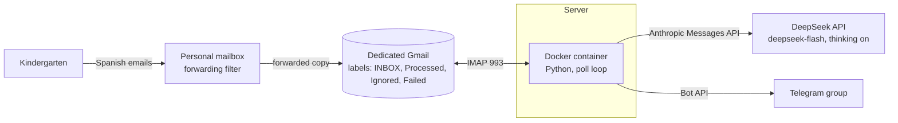
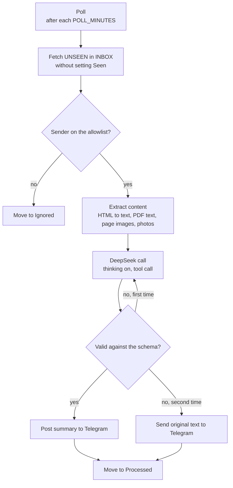
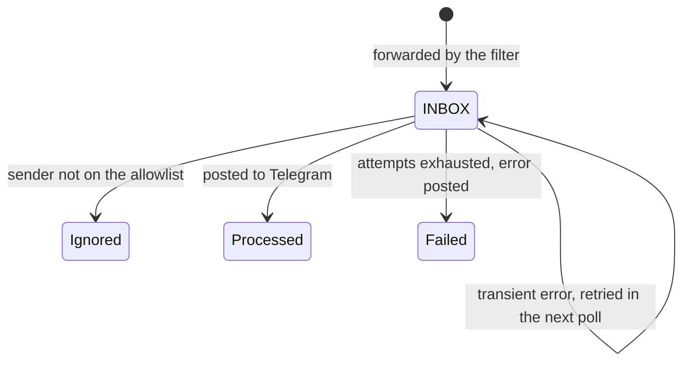

# Architecture

This document shows the parts of the app and how they work together.

## Purpose and constraints

The kindergarten sends emails in Spanish almost every day. Most are routine, some are urgent, some carry deadlines. The owner rarely reads email and wants every email turned into a short Russian summary with labels, delivered to a private Telegram group.

Constraints that shaped the design:

- The app must not have access to the owner's personal mailbox.
- Only emails from an allowlist of kindergarten senders are processed.
- Simple and cheap: one container, no database, no extra services.
- Model: DeepSeek `deepseek-flash` with thinking enabled.

## System overview



The container makes outbound connections only: IMAP to Gmail, HTTPS to DeepSeek and Telegram.

## Components

| Component | Responsibility | Where |
|---|---|---|
| Personal mailbox | One filter forwards mail from the kindergarten senders to the dedicated account | Owner's mail provider |
| Dedicated Gmail | Receives forwarded mail. Its labels are the only state (read "State model") | Google, app password over IMAP |
| App container | Long-running Python process: poll loop, extraction, model call, Telegram | `src/kindergarten_email_checker/` |
| DeepSeek | Summarization, through the Anthropic Messages API format | `api.deepseek.com/anthropic` |
| Telegram Bot API | Delivery to the private group | `api.telegram.org` |

Module map:

| Module | Role |
|---|---|
| `main.py` | Entry point and the poll loop: connect, fetch, process, move, log out |
| `config.py` | Settings from environment variables, with their defaults. Allowlist matching |
| `mail.py` | IMAP connection, fetching unseen mail, moving between labels |
| `content.py` | HTML to text, PDF text extraction, rendering scanned pages, size caps |
| `summarize.py` | Output schema, tool definition, the model call, validation and retry, the balance check |
| `telegram.py` | Message formatting, sendMessage, error posts, the start check with getChat |
| `health.py` | HTTP server for the Kubernetes probes, in a daemon thread |
| `prompt.md` | System prompt |

The [code walkthrough](code/README.md) describes each module in detail: its functions, constants, limits and errors.

## Runtime loop

1. At start: check Telegram, Gmail and DeepSeek. Telegram `getChat` checks the bot token and the group. A Gmail login checks the app password. DeepSeek `GET /user/balance` checks the API key and that the balance is above zero. This request is free. On failure: one error line, then the app stops with exit code 1. Docker or Kubernetes starts it again, with a longer delay after each failure. The app does not poll before all checks pass, because otherwise every email would fail and end in `Failed`.
2. Forever: poll the mailbox, then wait `POLL_MINUTES`. The first poll runs after the start check.
3. A poll opens a new IMAP connection, creates the state labels if missing, processes everything unseen and logs out.
4. An IMAP error ends the poll. The app closes the connection, and the next poll tries again. A failed or dropped connection (IMAP abort, socket, SSL or timeout error) gets one warning line without a traceback. Any other IMAP error gets a full traceback. The logout after a dropped connection fails too; that error is ignored. The loop never exits on its own.
5. Socket timeouts on IMAP and HTTP calls, so a stalled connection cannot block the loop.

The app does not use IMAP IDLE. IDLE needs a connection that stays open. Gmail and the network close such a connection a few times each day, and each drop writes a warning line. With a new connection for each poll, a drop is rare. The cost is a delay: a new email waits up to `POLL_MINUTES` for its post.

## Processing one email



1. Allowlist: the From address is compared with `ALLOWED_SENDERS`. Only an exact address matches, case-insensitive. Gmail forwarding keeps the From header intact. A non-matching sender is moved to `Ignored` with no notification.
2. Extraction: read "Content extraction".
3. Model call: read "The model call".
4. Telegram: read "Telegram output".
5. Move to `Processed`. This is the commit point.

## State model



- Unseen mail in `INBOX` is the queue. Fetching uses `mark_seen=False`; moving the email is the only state change the app makes.
- Moves use the IMAP MOVE command. After login the app reads the server's capability list again, because Gmail lists MOVE only after login. Without MOVE, the move falls back to copy and delete, and with some Gmail settings the email goes to Trash.
- Each poll creates the `Processed`, `Ignored` and `Failed` labels if they do not exist.
- Telegram is called before the move. A crash between the two produces one duplicate post, never a lost one.
- A per-UID attempt counter lives in memory. After `MAX_RETRIES_PER_MESSAGE` failures the email is moved to `Failed` and the error is posted once. The counter resets on restart, which only grants a few extra attempts.
- No database. Everything the app knows is visible in the Gmail web UI, which doubles as the admin interface.

## Content extraction

| Input | Handling | Reaches the model as |
|---|---|---|
| HTML body | Prefer the text/plain part when present, otherwise html2text | text |
| PDF with a text layer | pypdfium2 text extraction. A text layer counts as present when the average page has more than 200 characters | text |
| PDF without a text layer | pypdfium2 renders each page at about 110 dpi, Pillow saves it as PNG, at most 10 pages | images |
| PDF that cannot be read | Not sent to the model. The file name is listed in the prompt | nothing |
| JPEG, PNG, GIF, WebP | As is. Images under 20 KB are skipped as logos and signature graphics | images |
| Other files | Not sent to the model. The file names are listed in the prompt | nothing |

The limits in this section are settings with defaults. The list is in "Settings" in [SETUP.md](SETUP.md).

Caps: attachments above `MAX_ATTACHMENT_MB` are not sent to the model; body text is truncated at about 40,000 characters with a note. There is no cap on the total size of the images. Many large photos in one email can exceed DeepSeek's 48 MiB request limit. The model call then fails, and the email follows the normal retry path.

## The model call

- Endpoint: the Anthropic Messages API format served by DeepSeek at `https://api.deepseek.com/anthropic`, called with the `anthropic` SDK and a custom `base_url`.
- Model: `deepseek-flash` (DeepSeek-V4.1-Flash). Cheapest, accepts images, recommended by DeepSeek. `deepseek-v4-pro` is text-only.
- Thinking: enabled. The request carries `thinking={"type": "enabled", "budget_tokens": 8000}`; DeepSeek ignores `budget_tokens` and reads the effort from `output_config={"effort": LLM_EFFORT}`. The app reads only the tool call from the response. On a retry, the full previous response, thinking blocks included, goes back to the model.
- Output shaping: one tool, `report_summary`, whose `input_schema` is `Summary.model_json_schema()`. The request uses `tool_choice={"type": "auto"}`, and the system prompt tells the model to call the tool exactly once. DeepSeek rejects a forced tool choice when thinking is on (tested 2026-10-05: "Thinking mode does not support this tool_choice"). DeepSeek's Anthropic format has no structured-output mode and no JSON mode, so the tool call carries the schema.
- Validation: `Summary.model_validate(tool_use.input)`. For `action_ru`, `deadline`, `event_date` and `event_time`, the text values "null", "none" and an empty string count as no value. The model sometimes writes the text "null" instead of JSON null. When the model writes tool arguments that are not valid JSON, DeepSeek does not report an error: it returns the tool call with empty input `{}`, which fails validation. On a validation error: a retry with a `tool_result` block that carries the error. On a missing tool call: a retry with the message "Call the report_summary tool." The app calls the model at most `LLM_MODEL_TRIES` times, default 2. After the last failure: subject, sender and original text go to Telegram without a summary, and the email is still moved to `Processed`.
- API errors: the SDK retries timeouts, 429 and 5xx twice. After that the error goes to the main loop, which counts an attempt (read "Failure handling").
- Inputs: the system prompt from `prompt.md`; a user message with a metadata block (From, Subject, sent date in the `TZ` timezone, today's date), the body text, the PDF texts, the list of files not sent to the model, and the image blocks.
- `max_tokens`: 16,000, for thinking and the tool call together. The test call used about 830 output tokens.

Output schema:

| Field | Type | Meaning |
|---|---|---|
| `title_ru` | string | One line, up to 60 characters |
| `summary_ru` | string | At most three short sentences, under 350 characters. No addresses or phone numbers unless needed for the action |
| `urgency` | `low`, `medium`, `high` | How soon the parent must act. `high`: within two days from today, or attendance or schedule changes within two days. `medium`: later. `low`: nothing required, including conditional instructions. The topic does not set urgency |
| `category` | `info`, `event`, `action_required`, `payment`, `closure`, `health`, `other` | Shown in the post; nothing depends on it yet |
| `action_ru` | string or null | What the parent must do |
| `deadline` | date or null | When the parent must have acted |
| `event_date`, `event_time` | date or null, `HH:MM` or null | When the event happens |

Relative dates in the email are resolved by the model from the sent date, which is why the date and the timezone are part of the prompt.

## Telegram output

Post layout, HTML parse mode:

```text
🟡 Medium · 🎉 Мероприятие · ⏰ Срок: пт, 9 окт · 📅 Событие: вт, 20 окт 09:30
<b>Экскурсия в Ботанический сад</b>

summary_ru

<b>Что сделать:</b> action_ru
📎 Вложения: menu.pdf, autorizacion.pdf

<i>Тема: subject · От: sender · Отправлено: пт, 2 окт 2026 14:52</i>
```

Rules:

- Header line: urgency, category, deadline, event date and time. Absent fields are left out.
- Urgency labels: `🔴 High`, `🟡 Medium`, `🟢 Low`.
- Category labels: `ℹ️ Информация`, `🎉 Мероприятие`, `✍️ Нужно действие`, `💰 Оплата`, `🔄 Изменение расписания`, `🩺 Здоровье`, `📌 Другое`.
- All posts are sent the same way, with a normal notification. Urgency is only a label in the header line. Nothing is pinned.
- The post does not quote the original email. The original stays in the dedicated mailbox.
- Attachments: one line with the file names, except skipped small images. The files themselves are not sent.
- Footer: subject, sender and the date the email was sent, with the year and time, in the `TZ` timezone. For a manual forward, this is the date of the forward.
- Fallback post when the model output is unusable: `⚠️ Без сводки`, the attachment names and the original text in an expandable quote. This is the only post that quotes the email, because it has no summary. Telegram's limit is 4096 characters, so the original is trimmed to fit and ends with `…`.
- Log: one level, `LOG_LEVEL`, for the app and all libraries. The app and the Anthropic SDK send HTTP requests with the library `httpx2`. At `INFO`, `httpx2` logs the URL of each request. Telegram URLs contain the bot token, so the log shows the token. The app runs in a homelab, so this is accepted. Telegram error messages are built without the URL.
- Error post: `⚠️ Не удалось обработать письмо «subject»: error`, at most once per email. The error text is trimmed at `TELEGRAM_MAX_ERROR_CHARS` characters, default 500.

## Failure handling

IMAP errors are described in "Runtime loop".

| Failure | Behaviour |
|---|---|
| Model timeout, 5xx, 429 | Attempt counter +1, email stays unseen, retried in the next poll |
| Model output invalid `LLM_MODEL_TRIES` times in one attempt | Original text forwarded, email `Processed` |
| Telegram error | Attempt counter +1, email stays unseen |
| Attempts exhausted | Moved to `Failed`, error posted once |
| Process crash | Docker or Kubernetes restarts it. Nothing is lost because the state lives in Gmail |
| Wrong credentials or no connection at start | The app stops before the first poll. Docker or Kubernetes starts it again, with a longer delay after each failure. On Kubernetes, the pod is not ready. During an update, the old pod keeps working |
| HTTP server of the health checks does not answer | Kubernetes restarts the container (liveness probe). Docker Compose has no health check |

## Deployment

The app runs as one container from the image `ghcr.io/dev1l/kindergarten-email-checker`. CI builds the image and pushes it to ghcr.io. The host pulls the image and does not build it. There are three deployment options: local development, Docker Compose on a VPS, and Kubernetes with the Helm chart. Exactly one instance runs for each mailbox. The details are in "Start the app" in [SETUP.md](SETUP.md).

Health checks on Kubernetes call a small HTTP server in the app, port 8080. The server is `http.server` from the standard library, in a daemon thread. It adds less than 1 MB of memory. The main loop stays in one thread.

- `/readyz`: 200 after the start check passes, 503 before. The readiness probe uses it. The start check runs once, so the pod stays ready after it.
- `/livez`: always 200. The liveness probe restarts the container when the process does not answer.
- Only the readiness probe depends on Telegram, Gmail and DeepSeek. A restart does not fix an outage of these services.

The workflow **Deploy** in GitHub Actions runs `helm upgrade --install` with the chart of the selected branch. The image tag is `latest`, or a tag that the owner enters. The pod template has an annotation with a random value, so each upgrade replaces the pod, and the new pod pulls the tag again. With `--wait`, the workflow fails when the pod is not ready in 5 minutes, for example with wrong credentials.

The chart uses the `RollingUpdate` strategy with `maxSurge` 1 and `maxUnavailable` 0. On an update, the old pod runs until the new pod is ready. A new pod with wrong credentials stops before its first poll, so the old pod keeps working. After a successful start check, both pods poll for a short time: until the next readiness probe, at most 10 seconds, and the stop of the old pod. An email that arrives in this time can get two posts. The workflow runs only when the owner starts it.
