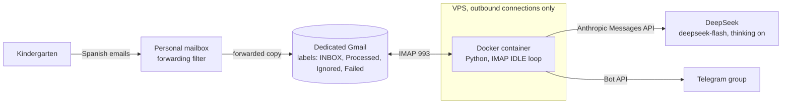
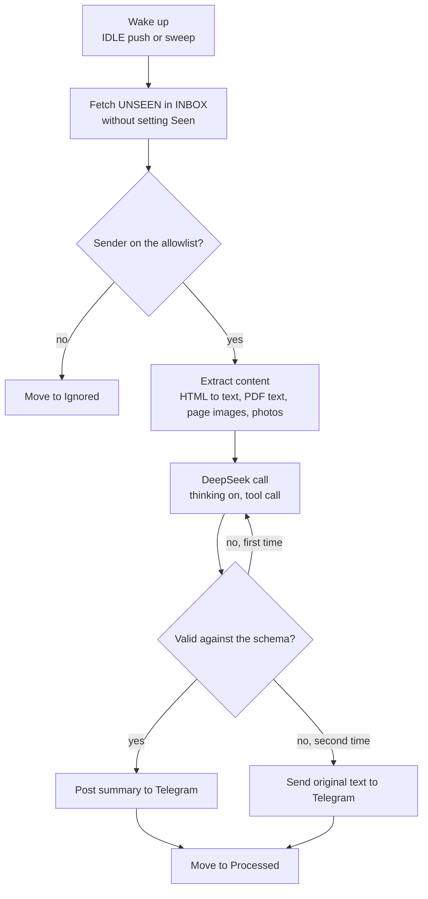

# Architecture

This is the reference for building the tool and for changing it later. The reasons behind each decision are in section 14. The current state of the work is in [STATUS.md](STATUS.md).

## 1. Purpose and constraints

The kindergarten sends emails in Spanish almost every day. Most are routine, some are urgent, some carry deadlines. The owner rarely reads email and wants every message turned into a short Russian summary with labels, delivered to a private Telegram group.

Constraints that shaped the design:

- The tool must not have access to the owner's personal mailbox.
- Only emails from an allowlist of kindergarten senders are processed.
- Python. Simple and cheap: one container on a VPS, no database, no extra services.
- Model: DeepSeek `deepseek-flash` with thinking enabled.

## 2. System overview



The container makes outbound connections only: IMAP to Gmail, HTTPS to DeepSeek and Telegram. Nothing listens on a port.

## 3. Components

| Component | Responsibility | Where |
|---|---|---|
| Personal mailbox | One filter forwards mail from the kindergarten senders to the dedicated account | Owner's mail provider |
| Dedicated Gmail | Receives forwarded mail. Its labels are the only state (section 6) | Google, app password over IMAP |
| App container | Long-running Python process: IDLE loop, extraction, model call, Telegram | `src/kindergarten_email_checker/` |
| DeepSeek | Summarization, through the Anthropic Messages API format | `api.deepseek.com/anthropic` |
| Telegram Bot API | Delivery to the private group | `api.telegram.org` |

Module map:

| Module | Role |
|---|---|
| `main.py` | Entry point and the wake, fetch, process, move loop |
| `config.py` | Settings from environment variables, allowlist matching |
| `mail.py` | IMAP session, IDLE wait, fetching unseen mail, moving between labels |
| `content.py` | HTML to text, PDF text extraction, rendering scanned pages, size caps |
| `summarize.py` | Output schema, tool definition, the model call, validation and retry |
| `telegram.py` | Message formatting, sendMessage, error posts |
| `prompt.md` | System prompt |

## 4. Runtime loop

1. On start: connect to IMAP, create the state labels if missing, process everything unseen.
2. Forever: issue IMAP IDLE and wait up to `SWEEP_MINUTES`. Return on new mail or on timeout. Process everything unseen. Repeat.
3. The sweep after a timeout catches anything IDLE missed and refreshes the session, which Gmail drops after roughly 30 minutes anyway.
4. On any IMAP error: close the connection, wait 30 seconds, reconnect. A dropped connection (IMAP abort, socket, SSL or timeout error) is normal: Gmail closes sessions, networks change, laptops sleep. It gets one warning line without a traceback. Any other IMAP error gets a full traceback. The logout after a dropped connection fails too; that error is ignored. The loop never exits on its own. Docker restarts the process if it crashes.
5. Socket timeouts on IMAP and HTTP calls, so a stalled connection cannot block the loop.

Plain polling is the same loop without the IDLE call. It is the fallback if IDLE misbehaves with Gmail.

## 5. Processing one email



1. Allowlist: the From address is compared with `ALLOWED_SENDERS`, exact address or `@domain` suffix, case-insensitive. Gmail forwarding keeps the From header intact. A non-matching sender is moved to `Ignored` with no notification.
2. Extraction: section 7.
3. Model call: section 8.
4. Telegram: section 9.
5. Move to `Processed`. This is the commit point.

## 6. State model


- Unseen mail in `INBOX` is the queue. Fetching uses `mark_seen=False`; moving the message is the only state change the tool makes.
- Moves use the IMAP MOVE command. After login the tool reads the server's capability list again, because Gmail lists MOVE only after login. Without MOVE, the move falls back to copy and delete, and with some Gmail settings the email goes to Trash.
- The tool creates the `Processed`, `Ignored` and `Failed` labels at start if they do not exist.
- Telegram is called before the move. A crash between the two produces one duplicate message, never a lost one.
- A per-UID attempt counter lives in memory. After `MAX_RETRIES_PER_MESSAGE` failures the message is moved to `Failed` and the error is posted once. The counter resets on restart, which only grants a few extra attempts.
- No database. Everything the tool knows is visible in the Gmail web UI, which doubles as the admin interface.

## 7. Content extraction

| Input | Handling | Reaches the model as |
|---|---|---|
| HTML body | Prefer the text/plain part when present, otherwise html2text | text |
| PDF with a text layer | pypdfium2 text extraction. A text layer counts as present when the average page has more than 200 characters | text |
| PDF without a text layer | pypdfium2 renders each page at about 110 dpi, Pillow saves it as PNG, at most 10 pages | images |
| PDF that cannot be read | Not sent to the model. The file name is listed in the prompt | nothing |
| JPEG, PNG, GIF, WebP | As is. Images under 20 KB are skipped as logos and signature graphics | images |
| Other files | Not sent to the model. The file names are listed in the prompt | nothing |

Caps: attachments above `MAX_ATTACHMENT_MB` are not sent to the model; the request body stays under DeepSeek's 48 MiB limit; body text is truncated at about 40,000 characters with a note.

Attachment files are not sent to Telegram. The post lists the attachment names, except skipped small images.

## 8. The model call

- Endpoint: the Anthropic Messages API format served by DeepSeek at `https://api.deepseek.com/anthropic`, called with the `anthropic` SDK and a custom `base_url`. Switching to a Claude model later is a base URL and model change.
- Model: `deepseek-flash` (DeepSeek-V4.1-Flash). Cheapest, accepts images, recommended by DeepSeek. `deepseek-v4-pro` is text-only.
- Thinking: enabled. The request carries `thinking={"type": "enabled", "budget_tokens": 8000}`; DeepSeek ignores `budget_tokens` and reads the effort from `output_config={"effort": LLM_EFFORT}`. The tool reads only the tool call from the response. On a retry, the full previous response, thinking blocks included, goes back to the model.
- Output shaping: one tool, `report_summary`, whose `input_schema` is `Summary.model_json_schema()`. The request uses `tool_choice={"type": "auto"}`, and the system prompt tells the model to call the tool exactly once. DeepSeek rejects a forced tool choice when thinking is on (tested 2026-10-05: "Thinking mode does not support this tool_choice"). DeepSeek's Anthropic format has no structured-output mode and no JSON mode, so the tool call carries the schema.
- Validation: `Summary.model_validate(tool_use.input)`. For `action_ru`, `deadline`, `event_date` and `event_time`, the text values "null", "none" and an empty string count as no value. The model sometimes writes the text "null" instead of JSON null. When the model writes tool arguments that are not valid JSON, DeepSeek does not report an error: it returns the tool call with empty input `{}`, which fails validation. On a validation error: one retry with a `tool_result` block that carries the error. On a missing tool call: one retry with the message "Call the report_summary tool." After two failures: subject, sender and original text go to Telegram without a summary, and the email is still moved to `Processed`.
- API errors: the SDK retries timeouts, 429 and 5xx twice. After that the error goes to the main loop, which counts an attempt (section 10).
- Inputs: the system prompt from `prompt.md`; a user message with a metadata block (From, Subject, sent date in America/Argentina/Buenos_Aires, today's date), the body text, the PDF texts, the list of files not sent to the model, and the image blocks.
- `max_tokens`: 16,000, for thinking and the tool call together. The test call used about 830 output tokens.

Output schema:

| Field | Type | Meaning |
|---|---|---|
| `title_ru` | string | One line, up to 60 characters |
| `summary_ru` | string | At most three short sentences, under 350 characters. No addresses or phone numbers unless needed for the action |
| `urgency` | `low`, `medium`, `high` | How soon the parent must act. `high`: within two days from today, or attendance or schedule changes within two days. `medium`: later. `low`: nothing required, including conditional instructions. The topic does not set urgency |
| `category` | `info`, `event`, `action_required`, `payment`, `closure`, `health`, `other` | Shown in the message; nothing depends on it yet |
| `action_ru` | string or null | What the parent must do |
| `deadline` | date or null | When the parent must have acted |
| `event_date`, `event_time` | date or null, `HH:MM` or null | When the event happens |

Relative dates in the email are resolved by the model from the sent date, which is why the date and the timezone are part of the prompt.

## 9. Telegram output

Message layout, HTML parse mode:

```text
🟡 Medium · 🎉 Мероприятие · ⏰ Срок: пт, 9 окт · 📅 Событие: вт, 20 окт 09:30
<b>Экскурсия в Ботанический сад</b>

summary_ru

<b>Что сделать:</b> action_ru
📎 Вложения: menu.pdf, autorizacion.pdf

<i>Тема: subject · От: sender · Отправлено: пт, 2 окт 2026 14:52</i>
```

Rules:

- Header line: urgency, category, deadline, event date and time. Absent fields are left out.
- Urgency labels: `🔴 High`, `🟡 Medium`, `🟢 Low`.
- Category labels: `ℹ️ Информация`, `🎉 Мероприятие`, `✍️ Нужно действие`, `💰 Оплата`, `🔄 Изменение расписания`, `🩺 Здоровье`, `📌 Другое`.
- All posts are sent the same way, with a normal notification. Urgency is only a label in the header line. Nothing is pinned.
- The post does not quote the original email. The original stays in the dedicated mailbox.
- Attachments: one line with the file names. The files themselves are not sent.
- Footer: subject, sender and the date the email was sent, with the year and time, in the `TZ` timezone. For a manual forward, this is the date of the forward.
- Fallback message when the model output is unusable: `⚠️ Без сводки`, the attachment names and the original text in an expandable quote. This is the only post that quotes the email, because it has no summary. Telegram's limit is 4096 characters, so the original is trimmed to fit and ends with `…`.
- Log hygiene: Telegram URLs contain the bot token. The tool sets the `httpx` and `httpx2` loggers to WARNING and builds Telegram error messages without the URL. The Anthropic SDK uses `httpx2`.
- Error post: `⚠️ Не удалось обработать письмо «subject»: error`, at most once per message.

## 10. Failure handling

| Failure | Behaviour |
|---|---|
| IMAP connection lost or IDLE error | One warning line, reconnect after 30 seconds, resume |
| Sender not on the allowlist | Moved to `Ignored`, no post |
| Attachment too large or of an unsupported type | Not sent to the model, named in the prompt and in the post |
| Model timeout, 5xx, 429 | Attempt counter +1, email stays unseen, retried next cycle |
| Model output invalid twice in one attempt | Original text forwarded, email `Processed` |
| Telegram error | Attempt counter +1, email stays unseen |
| Attempts exhausted | Moved to `Failed`, error posted once |
| Process crash | Docker restarts it. Nothing is lost because the state lives in Gmail |

## 11. Configuration

Everything comes from environment variables, loaded from `.env` by Docker Compose. `.env.example` is the reference. Secrets exist only in `.env` with mode 600, never in the image, the repository or the logs.

## 12. Deployment

- Image: `python:3.13-slim`, dependencies installed with pip from `pyproject.toml`, non-root user. CI builds it and pushes it to `ghcr.io/dev1l/kindergarten-email-checker`. The VPS pulls it; it does not build it.
- Container: `restart: unless-stopped`, read-only root filesystem with a tmpfs at `/tmp`, 256 MB memory limit, json-file logs rotated at 3 × 10 MB.
- VPS: inbound firewall closed except SSH with keys, unattended security updates. The tool needs nothing inbound.
- Files on the VPS: `compose.yaml` and `.env` only. `IMAGE_TAG` in `.env` selects the image tag, default `latest`.
- Deploy and update: `docker compose pull && docker compose up -d`.
- CI: `.github/workflows/ci.yml` runs the tests on pull requests and on manual runs. It builds the image and pushes it to `ghcr.io/dev1l/kindergarten-email-checker` on merges to `main` and on manual runs. On a manual run, the image is built only after the tests pass. On a merge to `main`, the tests do not run again; they ran on the pull request.
- Logs: `docker compose logs`. One log line per processed email with UID, sender, subject, urgency, deadline, Telegram message id and duration. An invalid model answer gives one warning line with a JSON object: the problem, the tool input and the validation errors. Failures are also posted to the group, so a broken run is noticed where the summaries are read.

## 13. Costs

| Item | Per month |
|---|---|
| VPS | about €4, shared with whatever else runs there |
| DeepSeek, about 25 emails with thinking on | cents, well under $1 |
| Gmail, Telegram | $0 |

## 14. Decision log

| Decision | Choice | Why | Rejected |
|---|---|---|---|
| Mail ingestion | Forwarding filter to a dedicated Gmail account | No access to the personal mailbox; filtering at the source; folders double as state | API access to the personal mailbox; inbound-email services with an own domain |
| Hosting | Docker container on a VPS | Long-running process allows IMAP IDLE; the owner runs a VPS anyway | Serverless functions, GitHub Actions cron |
| Scheduling | In-process IDLE plus a 10-minute sweep | Near real time; the compose file is the whole deployment | Host cron |
| Image delivery | CI pushes to ghcr.io, the VPS pulls | No source code or build tools on the VPS; the tested image is the deployed image | Building on the VPS |
| State | Gmail labels | Nothing to back up or migrate; visible in the Gmail UI | SQLite, a database |
| Model | `deepseek-flash`, thinking on | Cheapest, accepts images, quality is enough; thinking is a requirement | Claude models, `deepseek-v4-pro` |
| API format | Anthropic Messages format at DeepSeek | Thinking, tools and images supported; portable to Claude | OpenAI format, which has a JSON mode but no portability |
| Output shaping | Tool call with `tool_choice` auto, validated with Pydantic | Schema-shaped output that works with thinking on | Forced tool choice (rejected with thinking on); JSON mode (OpenAI format only); strict tool mode (requires thinking off) |
| PDFs | pypdfium2 for text and for rendering scans | DeepSeek accepts images but no documents; one library does both jobs | pypdf plus a renderer; OCR engines in the image |
| Dedicated mailbox provider | Gmail | App passwords still work for IMAP | Outlook.com, which requires OAuth for IMAP |
