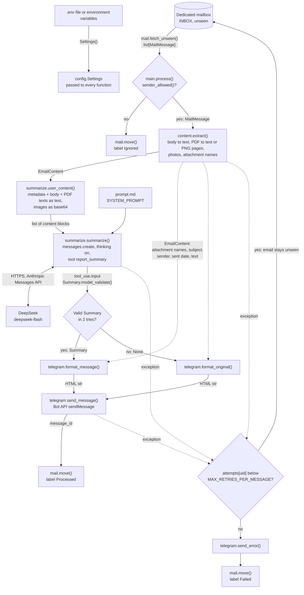
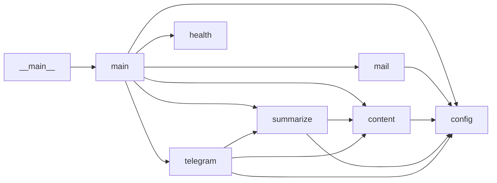

# Code walkthrough

This section explains the source code of the app, module by module. [ARCHITECTURE.md](../ARCHITECTURE.md) explains the design decisions. This section explains how the code carries them out.

## The whole picture

The app is one Python process. It has one thread for the work and one daemon thread for the health checks. It keeps no state on disk. The labels in the dedicated mailbox are the only state.

The process has two phases:

1. Start. `main.run()` reads the settings, starts the health server and runs the start check. The start check calls Telegram, Gmail and DeepSeek once. When one of them fails, the process stops with exit code 1.
2. Loop. `main.loop()` runs one poll, then waits `POLL_MINUTES`. It never returns. A poll connects to the dedicated mailbox, processes every unseen email and logs out.

The processing of one email is a pipeline of pure transformations with two side effects at the end:

| Step | Function | Input | Output |
|------|----------|-------|--------|
| 1. Fetch | `mail.fetch_unseen()` | The inbox label | `list[MailMessage]` |
| 2. Filter | `Settings.sender_allowed()` | The From address | `bool` |
| 3. Extract | `content.extract()` | `MailMessage` | `EmailContent` |
| 4. Build the request | `summarize.user_content()` | `EmailContent` | Content blocks: one text block and zero or more image blocks |
| 5. Summarize | `summarize.summarize()` | Content blocks and `prompt.md` | `Summary`, or `None` after two invalid answers |
| 6. Format | `telegram.format_message()` or `telegram.format_original()` | `Summary` and `EmailContent` | HTML text, at most 4096 characters |
| 7. Post | `telegram.send_message()` | HTML text | The Telegram message id. Side effect 1 |
| 8. Commit | `mail.move()` | The email UID | The email has a new label. Side effect 2 |

The post comes before the move. A crash between them gives one duplicate post on the next poll, never a lost email.

## Data flow

The diagram shows how one email moves through the modules. Each arrow carries the data type that one function gives to the next.

Solid arrows are the normal path. Dotted arrows are extra data and exceptions.

## Module map

| Module | Role | Walkthrough |
|--------|------|-------------|
| `__init__.py`, `__main__.py` | The package version and the `python -m` entry point | [package.md](package.md) |
| `main.py` | Start, start check, poll loop, processing of one email | [main.md](main.md) |
| `config.py` | Settings from environment variables. Allowlist matching | [config.md](config.md) |
| `mail.py` | IMAP connection, fetch, move between labels | [mail.md](mail.md) |
| `content.py` | One email to text and images for the model | [content.md](content.md) |
| `summarize.py`, `prompt.md` | The model call, the output schema, the balance check, the system prompt | [summarize.md](summarize.md) |
| `telegram.py` | Post formatting and the Bot API calls | [telegram.md](telegram.md) |
| `health.py` | HTTP server for the Kubernetes probes | [health.md](health.md) |

Import dependencies. An arrow points from the module that imports to the module that it imports:

`config` imports no module of the app. `health` imports no module of the app. `main` is the only module that calls `mail` and `health`.

## Process lifecycle

## Exit codes

The process never stops on its own after the start check. These are all the ways it ends:

| Exit code | Cause | Log output |
|-----------|-------|------------|
| 0 | `run()` returns 0. This does not happen in practice, because `loop()` does not return | None |
| 1 | The start check fails: Telegram, Gmail or DeepSeek. `check_services()` raises `SystemExit(1)` | One line: `start check failed (<error type>: <message>), exiting` |
| 1 | A required setting is missing or has the wrong type. `Settings()` raises `pydantic.ValidationError` | A traceback with one entry for each wrong setting |
| 1 | Another error before the loop. For example: `LOG_LEVEL` is not a level name, or `HEALTH_PORT` is in use | A traceback |
| 130 | Ctrl+C in a local run. Python raises `KeyboardInterrupt` | A traceback |
| 137 | `docker stop` or a pod deletion. The app has no `SIGTERM` handler. In the container the app is process 1, and Linux does not deliver `SIGTERM` to process 1 without a handler. Docker sends `SIGKILL` after 10 seconds, Kubernetes after 30 seconds | None |

A stop at any time is safe, because the state is in Gmail. The worst case is one duplicate post: the app posted the summary but did not move the email yet.

Errors inside a poll do not end the process. [main.md](main.md) describes how `poll()` and `process()` handle them.

## Limits and retries in one place

| Limit | Default | Where | Effect |
|-------|---------|-------|--------|
| `POLL_MINUTES` | 10 | `main.loop()` | Pause after each poll |
| `MAX_RETRIES_PER_MESSAGE` | 3 | `main.process()` | Failed attempts for one email before the label `Failed` |
| Model tries in one attempt | 2 | `summarize.summarize()` | Fixed in the code. A second try only after an invalid answer |
| SDK retries | 2 | `anthropic` SDK default | Retries of one HTTP request after a timeout, 429 or 5xx |
| `LLM_MAX_TOKENS` | 16,000 | `summarize.summarize()` | Output limit for thinking and the tool call together |
| `MAX_BODY_CHARS` | 40,000 | `content.body_text()` | Body text is cut, with a note |
| `MAX_PDF_TEXT_CHARS` | 20,000 | `content.extract()` | Text of one PDF is cut, without a note |
| `MAX_PDF_PAGES_RENDERED` | 10 | `content.pdf_to_text_or_images()` | Pages of one scanned PDF sent as images |
| `MAX_ATTACHMENT_MB` | 10 | `content.extract()` | Larger files are named, not sent to the model |
| `MIN_IMAGE_BYTES` | 20,480 | `content.extract()` | Smaller images are skipped completely |
| `TELEGRAM_MAX_MESSAGE_CHARS` | 4096 | `telegram.py` | Posts are cut to this length |
| Error text in an error post | 500 characters | `telegram.send_error()` | Fixed in the code |

In the worst case, one email causes 18 HTTP requests to DeepSeek before the label `Failed`: 3 attempts, 2 model tries in each attempt, 3 HTTP tries in each model try.

[config.md](config.md) lists every setting and its timeout.

## How to read a walkthrough

Each walkthrough has the same sections:

| Section | Content |
|---------|---------|
| Purpose | What the module does |
| Who runs it | The callers, and when they call |
| Layout | Every section, class and function, in source order. For a class: why it is a class |
| Constants, limits and flags | Module constants, settings that the module reads, fixed values in the code |
| Errors and exit codes | What the module raises, and what happens then |
| Tests | The test file and what it covers |
