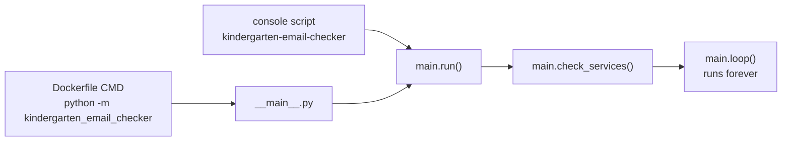
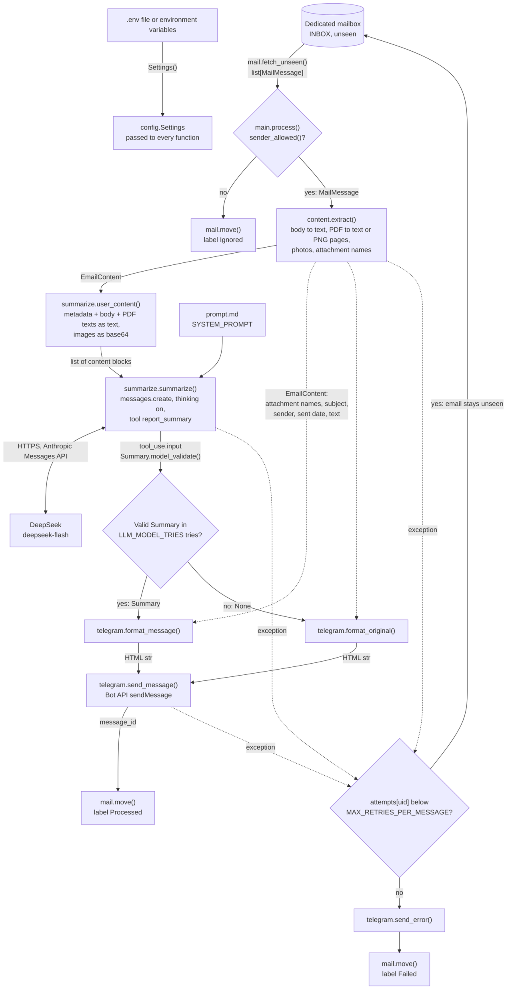
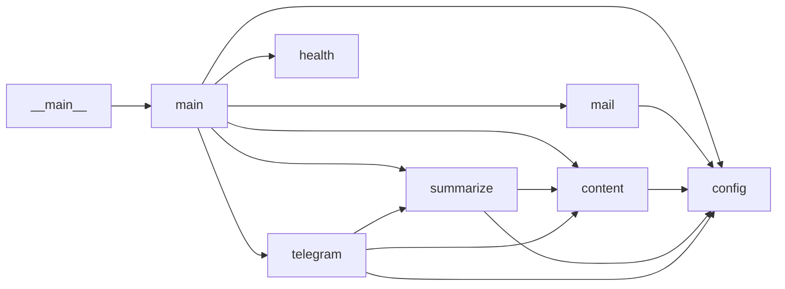
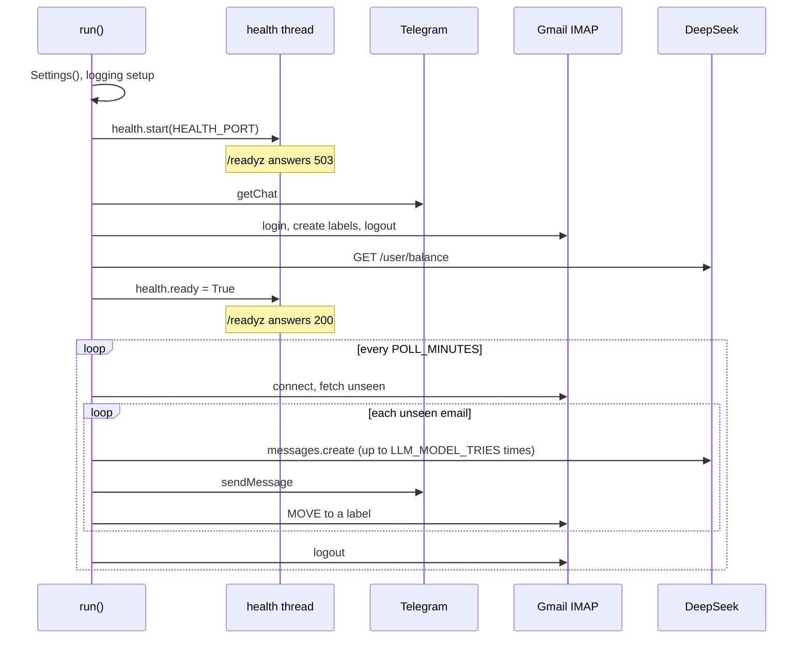

# Code walkthrough

This section explains the source code of the app, module by module. [ARCHITECTURE.md](../ARCHITECTURE.md) explains the design decisions. This section explains how the code carries them out.

All modules are in [src/kindergarten_email_checker/](../../src/kindergarten_email_checker/). The walkthroughs write a function as `module.function()`. For example, `main.run()` is the function `run()` in the file `main.py`. `Settings.sender_allowed()` is the method `sender_allowed()` of the class `Settings`.

## The whole picture

The app is one Python process. It has one thread for the work and one daemon thread for the health checks. It keeps no state on disk. The labels in the dedicated mailbox are the only state.

The process has two phases:

1. Start. `main.run()` reads the settings, starts the health server and runs the start check. The start check calls Telegram, Gmail and DeepSeek once. When one of them fails, the process stops with exit code 1.
2. Loop. `main.loop()` runs one poll, then waits `POLL_MINUTES`. It never returns. A poll connects to the dedicated mailbox, processes every unseen email and logs out.

## How the process starts

The container runs this command, from the `Dockerfile`:

```bash
python -m kindergarten_email_checker
```

The option `-m` tells Python to run a package. Python then looks for the file `__main__.py` in the package and runs it. Without `__main__.py`, the command fails: Python reports that the package "cannot be directly executed".

`__main__.py` has two lines of code:

1. It imports `run()` from `main.py`.
2. It calls `run()` and gives the return value to `SystemExit`. Python uses this value as the exit code of the process.

`__main__.py` holds no logic. Python requires the name `__main__.py`. The name `main.py` is the choice of this project. The code of the start and the loop is in `main.py`. The console script and the tests import it from there.



A second way to start the app is the console script `kindergarten-email-checker`. `pip install` creates it from `[project.scripts]` in `pyproject.toml`. It calls `main.run()` directly, without `__main__.py`.

The processing of one email is a pipeline of pure transformations with two side effects at the end:

| Step | Function | Input | Output |
|------|----------|-------|--------|
| 1. Fetch | `mail.fetch_unseen()` | The inbox label | `list[MailMessage]` |
| 2. Filter | `Settings.sender_allowed()` | The From address | `bool` |
| 3. Extract | `content.extract()` | `MailMessage` | `EmailContent` |
| 4. Build the request | `summarize.user_content()` | `EmailContent` | Content blocks: one text block and zero or more image blocks |
| 5. Summarize | `summarize.summarize()` | Content blocks and `prompt.md` | `Summary`, or `None` after `LLM_MODEL_TRIES` unusable answers |
| 6. Format | `telegram.format_message()` or `telegram.format_original()` | `Summary` and `EmailContent` | HTML text, at most 4096 characters |
| 7. Post | `telegram.send_message()` | HTML text | The Telegram message id. Side effect 1 |
| 8. Commit | `mail.move()` | The email UID | The email has a new label. Side effect 2 |

The post comes before the move. A crash between them gives one duplicate post on the next poll, never a lost email.

## Data flow

The diagram shows how one email moves through the modules. Each arrow carries the data type that one function gives to the next.



Solid arrows are the normal path. Dotted arrows are extra data and exceptions.

## Module map

| Module | Role | Walkthrough |
|--------|------|-------------|
| `__init__.py`, `__main__.py` | The package version and the `python -m` entry point | [package.md](package.md) |
| `main.py` | Start, start check, poll loop, processing of one email | [main.md](main.md) |
| `config.py` | Settings from environment variables. Allowlist matching | [config.md](config.md) |
| `mail.py` | IMAP connection, fetch, move between labels | [mail.md](mail.md) |
| `content.py` | One email to text and images for the model | [content.md](content.md) |
| `summarize.py`, `prompt.md` | The model call, the output schema, the balance check, the system prompt | [summarize.md](summarize.md) |
| `telegram.py` | Post formatting and the Bot API calls | [telegram.md](telegram.md) |
| `health.py` | HTTP server for the Kubernetes probes | [health.md](health.md) |

Import dependencies. An arrow points from the module that imports to the module that it imports:



`config` imports no module of the app. `health` imports no module of the app. `main` is the only module that calls `mail` and `health`.

## Process lifecycle



## Exit codes

The process never stops on its own after the start check. These are all the ways it ends:

| Exit code | Cause | Log output |
|-----------|-------|------------|
| 0 | `run()` returns 0. This does not happen in practice, because `loop()` does not return | None |
| 1 | The start check fails: Telegram, Gmail or DeepSeek. `check_services()` raises `SystemExit(1)` | One line: `start check failed (<error type>: <message>), exiting` |
| 1 | A required setting is missing or has the wrong type. `Settings()` raises `pydantic.ValidationError` | A traceback with one entry for each wrong setting |
| 1 | Another error before the loop. For example: `LOG_LEVEL` is not a level name, or `HEALTH_PORT` is in use | A traceback |
| 130 | Ctrl+C in a local run. Python raises `KeyboardInterrupt` | A traceback |
| 137 | `docker stop` or a pod deletion. The app has no `SIGTERM` handler. In the container the app is process 1, and Linux does not deliver `SIGTERM` to process 1 without a handler. Docker sends `SIGKILL` after 10 seconds, Kubernetes after 30 seconds | None |

A stop at any time is safe, because the state is in Gmail. The worst case is one duplicate post: the app posted the summary but did not move the email yet.

Errors inside a poll do not end the process. [main.md](main.md) describes how `poll()` and `process()` handle them.

## Retries

The app repeats a failed model call on three levels. An attempt contains model tries. A model try contains HTTP tries.

Example with the defaults: DeepSeek is down. In each poll, the SDK sends 3 requests, and all of them fail. The attempt fails, and the email stays unseen. After the third failed attempt, the app moves the email to `Failed`.

| Level | Name | Where | Repeats when | Maximum | After the maximum |
|-------|------|-------|--------------|---------|-------------------|
| 1 | Attempt | `main.process()` | Any error in extraction, the model call or Telegram | `MAX_RETRIES_PER_MESSAGE`, default 3 | The app posts the error and moves the email to `Failed` |
| 2 | Model try | `summarize.summarize()` | DeepSeek answers, but the answer is unusable | `LLM_MODEL_TRIES`, default 2 | `summarize()` returns `None`. The app posts the original text and moves the email to `Processed` |
| 3 | HTTP try | The `anthropic` SDK | The HTTP request fails: no connection, timeout, status 408, 409, 429 or 5xx | 3: the first request and 2 retries | The SDK raises the error. Level 1 counts a failed attempt |

### Attempt

An attempt is one run of `main.process()` for one email. When the attempt fails, the email stays unseen in the inbox label. The next poll, `POLL_MINUTES` later, makes the next attempt. The attempt counter is in memory, so a restart sets it to zero.

### Model try

A model try is one call of `client.messages.create()` in `summarize.summarize()`. `summarize()` makes another model try only when the answer is unusable (it has no call of `report_summary`, or the call input does not match `Summary`). The limit is `LLM_MODEL_TRIES` tries. The two cases in detail:

1. The answer has no call of the tool `report_summary`.
2. The input of the tool call does not match the schema `Summary`. For example, `urgency` is `"urgent"`, or `deadline` is not a date.

Each further model try sends the previous answers back to the model, with a message that names the problem. The model can then correct its answer. After `LLM_MODEL_TRIES` unusable answers, the email still gets a post: the original text without a summary. This is not a failure, and the attempt counter does not change.

An API error is not an unusable answer. `summarize()` does not repeat it. The error goes to level 1.

### HTTP try

An HTTP try is one HTTP request from the `anthropic` SDK to DeepSeek. The SDK repeats a failed request by itself, before `summarize()` sees an error.

The SDK repeats a request after these failures:

| Failure | Example |
|---------|---------|
| No connection or a timeout | The network is down. DeepSeek does not answer in `LLM_TIMEOUT_SECONDS` |
| Status 408 or 409 | Request timeout or conflict on the server |
| Status 429 | Too many requests |
| Status 500 or higher | A server error at DeepSeek |

Before a retry, the SDK waits. When the answer has the header `Retry-After`, the SDK waits that time. Otherwise it waits about 0.5 seconds before the first retry and about 1 second before the second retry. Other errors, for example 400 or 401, are not repeated.

The SDK writes one `INFO` line for each retry: `Retrying request to <URL> in <n> seconds`. The URL is the DeepSeek endpoint. It contains no secret.

Each HTTP try has its own timeout of `LLM_TIMEOUT_SECONDS`.

The Telegram requests and the IMAP commands have no level 3. One failed request fails the attempt.

### The worst case

With the defaults, one email can cause 18 HTTP requests to DeepSeek before the label `Failed`: 3 attempts × 2 model tries × 3 HTTP tries.

## Limits in one place

Each limit is a setting: a variable in `.env`. A restart applies the new value.

| Limit | Default | Where | Effect |
|-------|---------|-------|--------|
| `POLL_MINUTES` | 10 | `main.loop()` | Pause after each poll |
| `MAX_RETRIES_PER_MESSAGE` | 3 | `main.process()` | Attempts for one email before the label `Failed` |
| `LLM_MODEL_TRIES` | 2 | `summarize.summarize()` | Model calls in one attempt. Read "Model try" |
| `LLM_TIMEOUT_SECONDS` | 120 | `summarize.make_client()` | Timeout of one HTTP try |
| `LLM_MAX_TOKENS` | 16,000 | `summarize.summarize()` | Output limit for thinking and the tool call together |
| `MAX_BODY_CHARS` | 40,000 | `content.body_text()` | Body text is cut, with a note |
| `MAX_PDF_TEXT_CHARS` | 20,000 | `content.extract()` | Text of one PDF is cut, without a note |
| `MAX_PDF_PAGES_RENDERED` | 10 | `content.pdf_to_text_or_images()` | Pages of one scanned PDF sent as images |
| `MAX_ATTACHMENT_MB` | 10 | `content.extract()` | Larger files are named, not sent to the model |
| `MIN_IMAGE_BYTES` | 20,480 | `content.extract()` | Smaller images are skipped completely |
| `TELEGRAM_MAX_MESSAGE_CHARS` | 4096 | `telegram.py` | Posts are cut to this length |
| `TELEGRAM_MAX_ERROR_CHARS` | 500 | `telegram.send_error()` | A longer error text is cut |

[config.md](config.md) lists every setting, its default and whether it is required.

## How to read a walkthrough

Each walkthrough has the same sections:

| Section | Content |
|---------|---------|
| Purpose | What the module does |
| Who runs it | The callers, and when they call |
| Layout | Every section, class and function, in source order. For a class: why it is a class |
| Constants, limits and flags | Module constants, settings that the module reads, values written in the code |
| Errors and exit codes | What the module raises, and what happens then |
| Tests | The test file and what it covers |

In the tables of constants and limits, "code only" means that no setting changes the value. To change it, edit the code and build a new image.
