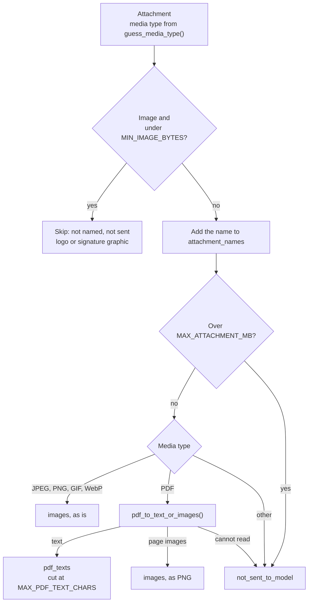

# content.py

Source: [src/kindergarten_email_checker/content.py](../../src/kindergarten_email_checker/content.py)

## Purpose

`content.py` turns one email into the inputs for the model. It converts the body to plain text, the PDFs to text or page images, and keeps the photos as images. It also collects the names of the attachments for the post. It makes no network calls.

## Who runs it

| Caller | How |
|--------|-----|
| `main.process()` | Calls `extract()` once for each email from an allowed sender |
| `summarize.py` | Imports `EmailContent` as a type. `user_content()` reads its fields |
| `telegram.py` | Imports `EmailContent` as a type. The post reads the subject, sender, date, attachment names and text |

## Layout

| Item | Kind |
|------|------|
| Module docstring | One line |
| `log` | Module logger |
| `IMAGE_TYPES` | Constant |
| `EmailContent` | Dataclass |
| `extract()` | Function: the entry point of the module |
| `body_text()` | Function |
| `html_to_text()` | Function |
| `guess_media_type()` | Function |
| `pdf_to_text_or_images()` | Function |

### `EmailContent`

A dataclass that holds everything the later steps need from one email:

| Field | Type | Meaning | Read by |
|-------|------|---------|---------|
| `uid` | `str` | IMAP UID of the email | `summarize` log lines |
| `sender` | `str` | From address | Prompt, post footer |
| `subject` | `str` | Subject, or `(без темы)` when empty | Prompt, post footer |
| `sent_at` | `datetime` | Send date in the `TZ` timezone | Prompt, post footer |
| `text` | `str` | Body as plain text | Prompt, fallback post |
| `pdf_texts` | `list[tuple[str, str]]` | (file name, text) of each PDF with a text layer | Prompt |
| `images` | `list[tuple[str, bytes]]` | (media type, bytes) of each photo and each rendered PDF page | Prompt, as image blocks |
| `attachment_names` | `list[str]` | Every attachment except skipped small images | Post |
| `not_sent_to_model` | `list[str]` | Attachments that are named but not sent | Prompt |

Why it is a class: three modules share this record, and each reads different fields. A dataclass gives named, typed fields and empty lists as defaults. It is not a pydantic model, because the code fills it and no outside data needs validation. It has no methods.

The `MailMessage` from `imap-tools` is not passed on. After `extract()`, only `EmailContent` reaches the model and Telegram.

### `extract(message, settings) -> EmailContent`

1. Takes the send date from the `Date` header. When the header is missing, `imap-tools` returns 1900-01-01. A year before 2000 counts as missing, and the function uses the current time. It converts the date to the `TZ` timezone.
2. Creates `EmailContent` with the UID, sender, subject and body text from `body_text()`.
3. Sorts each attachment:

An attachment without a file name gets the name `без имени`.

### `body_text(message, settings) -> str`

1. Takes the `text/plain` part. When it is empty, it converts the `text/html` part with `html_to_text()`.
2. Replaces three or more line breaks with two.
3. When the text is longer than `MAX_BODY_CHARS`, cuts it and adds the line `[текст обрезан]` (text cut). The model then knows that the text is incomplete.

### `html_to_text(html) -> str`

Converts HTML to text with `html2text`. Images and links are removed. `body_width = 0` turns off line wrapping, so a sentence stays on one line.

### `guess_media_type(content_type, filename) -> str`

Returns the content type of the attachment in lower case. Some mail clients send every file as `application/octet-stream`. For this type, and for an empty type, the function guesses from the file name extension with `mimetypes`. It returns an empty string when it cannot guess.

### `pdf_to_text_or_images(data, settings) -> tuple[str | None, list[bytes]]`

| Result | Meaning |
|--------|---------|
| `(text, [])` | The PDF has a text layer |
| `(None, [png, ...])` | The PDF is a scan. The list holds the rendered pages |
| `(None, [])` | The PDF cannot be opened or read |

1. Opens the PDF with `pypdfium2`. On an error, writes a warning and returns `(None, [])`.
2. Extracts the text of every page. Computes the average number of characters per page, without spaces at the start and end.
3. When the average is more than `PDF_TEXT_MIN_CHARS_PER_PAGE`, returns the page texts joined with blank lines.
4. Otherwise, renders the first `MAX_PDF_PAGES_RENDERED` pages. The scale is `PDF_RENDER_DPI / 72`, because PDF units are 1/72 inch. Pillow saves each page as PNG.
5. Closes the PDF in `finally`.

The average decides for the whole file. A PDF with some text pages and some scanned pages goes one way only.

## Constants, limits and flags

| Name | Value | Meaning |
|------|-------|---------|
| `IMAGE_TYPES` | `image/jpeg`, `image/png`, `image/gif`, `image/webp` | Image types that the model accepts. Other images are named but not sent |
| `MIN_IMAGE_BYTES` | Setting, 20,480 | Smaller images are skipped completely |
| `MAX_ATTACHMENT_MB` | Setting, 10 | Larger attachments are named but not sent |
| `MAX_BODY_CHARS` | Setting, 40,000 | Body cut, with a note |
| `MAX_PDF_TEXT_CHARS` | Setting, 20,000 | PDF text cut, without a note |
| `PDF_TEXT_MIN_CHARS_PER_PAGE` | Setting, 200 | Text layer threshold |
| `MAX_PDF_PAGES_RENDERED` | Setting, 10 | Further pages of a scan are dropped without a note |
| `PDF_RENDER_DPI` | Setting, 110 | Resolution of rendered pages |
| `TZ` | Setting | Timezone of `sent_at` |
| `(без темы)`, `без имени`, `[текст обрезан]` | Text, code only | Subject placeholder, file name placeholder, cut note |

There is no limit on the number of images or on their total size. Each file is checked against `MAX_ATTACHMENT_MB` alone. Many large photos in one email can make the request larger than the DeepSeek limit of 48 MiB. The model call then fails, and the email follows the normal retry path.

## Errors and exit codes

| Situation | Result |
|-----------|--------|
| A PDF that cannot be opened or read | A warning line. The file is named in `not_sent_to_model` |
| A wrong `TZ` name | `ZoneInfoNotFoundError` goes to `main.process()`, which counts a failed attempt |
| Any other error | Goes to `main.process()`, which counts a failed attempt |

## Tests

`tests/test_content.py` uses emails from `helpers.make_message()` and PDFs from `helpers.text_pdf()` and `helpers.blank_pdf()`. It covers:

- HTML to text removes tags and links;
- the media type comes from the file name for `application/octet-stream`;
- metadata and an HTML-only body;
- the sorting of attachments: small image, photo, text PDF, scanned PDF, other file;
- a large attachment is named but not sent;
- a broken PDF is named but not sent.
