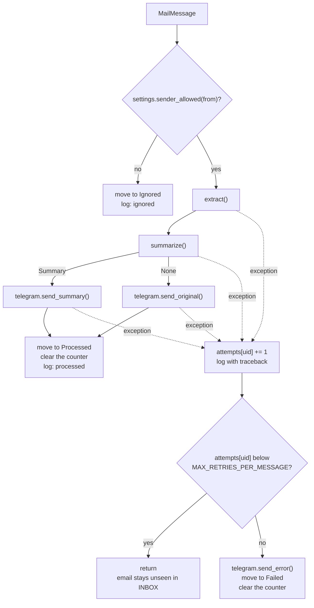

# main.py

Source: [src/kindergarten_email_checker/main.py](../../src/kindergarten_email_checker/main.py)

## Purpose

`main.py` is the entry point and the main loop. It starts the app, runs the start check, and then runs one poll every `POLL_MINUTES`. For each unseen email it calls the other modules in order and moves the email to its outcome label. It is the only module that decides what happens after an error. It also runs the HTTP server for the Kubernetes probes.

## Who runs it

| Caller | How |
|--------|-----|
| The container | `CMD ["python", "-m", "kindergarten_email_checker"]` in the `Dockerfile`. `__main__.py` calls `run()` |
| A local run | `python -m kindergarten_email_checker`, or the console script `kindergarten-email-checker` from `pyproject.toml` |
| Tests | `tests/test_main.py` calls `check_services()`, `poll()`, `process()` and `start_health()` directly |
| Kubernetes | The readiness probe calls `/readyz` every `readinessPeriodSeconds` seconds, default 10. The liveness probe calls `/livez` every `livenessPeriodSeconds` seconds, default 60. Both are chart values |

## Layout

| Item | Kind |
|------|------|
| Module docstring | Summary of the loop |
| `log` | Logger named `kindergarten_email_checker` |
| `CONNECTION_ERRORS` | Constant |
| `ready` | Module variable: the result of the start check, for `/readyz` |
| `run()` | Function: process start |
| `check_services()` | Function: start check |
| `loop()` | Function: the endless loop |
| `poll()` | Function: one poll |
| `process()` | Function: one email |
| `health_status()` | Function: status code for a probe path |
| `HealthHandler` | Class: HTTP request handler for the probes |
| `start_health()` | Function: starts the HTTP server for the probes |

The loop has one piece of state, the attempt counter. It is a plain `dict`, and `loop()` passes it to `poll()` and `process()` as an argument. A class would only hold this one dict. The only class is `HealthHandler`, because `http.server` requires one.

### `log`

The logger has the package name, `kindergarten_email_checker`, not `__name__`. The log lines from `main.py` show the package name. The loggers of the other modules are its children, for example `kindergarten_email_checker.summarize`.

### `run() -> int`

The console entry point. It runs once.

1. Creates `Settings()`. A missing required variable stops the process here with a `ValidationError`.
2. Sets up logging to stdout with the level from `LOG_LEVEL`. The format is `time level logger: message`. All loggers use this level: the app and all libraries.
3. Writes one start line: version, dedicated mailbox, model, poll interval. The line contains no secret.
4. Starts the HTTP server for the probes with `start_health()`.
5. Runs `check_services()`.
6. Runs `loop()`. This call does not return.
7. Returns 0. The code never gets here in practice.

At `INFO`, the HTTP library `httpx2` writes one line for each request, with the URL. The URL of a Telegram request contains the bot token, so the log shows the token.

### `check_services(settings)`

The start check. It runs three checks in order:

| Call | What a failure means |
|------|----------------------|
| `telegram.check()` | Wrong bot token, wrong chat id, or the bot is not in the group |
| `mail.close(mail.connect())` | Wrong app password, or no connection to Gmail. It also creates the state labels |
| `summarize.check_balance()` | Wrong API key, or the DeepSeek balance is zero |

The first failure stops the check. The function catches every exception, writes one error line with the exception type and message, and raises `SystemExit(1)`. `from None` removes the traceback. When all checks pass, it sets `ready = True` and writes the DeepSeek balance to the log.

The check runs only once. The app does not poll before the check passes: with wrong credentials, every email would fail and end in `Failed`.

### `loop(settings)`

Creates the attempt counter `attempts: dict[str, int]`, then repeats forever: `poll()`, then `time.sleep(POLL_MINUTES * 60)`. The first poll runs at once after the start check. The pause counts from the end of a poll, so the real interval is `POLL_MINUTES` plus the duration of the poll.

The counter maps an email UID to the number of failed attempts. It lets the app stop retrying an email that always fails. A failed email stays unseen in the inbox label, so without the counter each poll would try it again forever. The counter lives in memory, because the labels are the only state. A restart clears it, so an email can get up to `MAX_RETRIES_PER_MESSAGE` new attempts after each restart.

### `poll(settings, attempts)`

One poll:

1. Connects with `mail.connect()`.
2. Writes a `DEBUG` line. At `INFO`, a poll without new email writes nothing.
3. Fetches all unseen emails with `mail.fetch_unseen()` and calls `process()` for each.
4. In `finally`: logs out with `mail.close()`, when the connection exists.

Error handling:

| Exception | Log output | Result |
|-----------|------------|--------|
| One of `CONNECTION_ERRORS` | One `WARNING` line, no traceback | The poll ends. The next poll tries again |
| Any other exception | `ERROR` line with a traceback | The poll ends. The next poll tries again |

`process()` catches the errors of extraction, the model and Telegram itself. The exceptions that reach `poll()` come from IMAP: the connection, the fetch or a move. The remaining emails of this poll wait for the next poll.

### `process(mailbox, message, settings, attempts)`

Handles one email and moves it to its outcome label.

Details:

- The allowlist check comes first and is outside the `try` block. An ignored email gets no post. An IMAP error in this move goes to `poll()`.
- `summarize()` returns `None` after `LLM_MODEL_TRIES` unusable model answers. This is not an error: the app posts the original text and moves the email to `Processed`.
- The `try` block catches `Exception`. On an error, the email stays unseen, and the next poll tries it again.
- When the counter reaches `MAX_RETRIES_PER_MESSAGE`, the app posts the error to the group with `telegram.send_error()`. When this post fails too, the app writes the error to the log and still moves the email to `Failed`.
- The move to `Processed` comes after the post. This move is the commit.
- The success line contains the UID, sender, subject, urgency, deadline, Telegram message id and duration. It contains no secret and no body text. `time.monotonic()` measures the duration.

### Health checks

An HTTP server in a daemon thread answers the Kubernetes probes. It uses `http.server` from the standard library. A daemon thread does not keep the process alive. On Docker Compose the server runs too, but nothing calls it.

The module variable `ready` connects the two threads. `check_services()` in the main thread sets it to `True` once. The server thread reads it. It has one writer, so it needs no lock.

`health_status(path)` returns the status code for a path:

| Path | Status |
|------|--------|
| `/readyz` | 200 when `ready` is `True`, otherwise 503 |
| `/livez` | Always 200 |
| Any other path | 404 |

`/livez` shows that the process runs and that its server thread answers. When the process is frozen completely, the probe gets no answer, and Kubernetes restarts the container. `/livez` does not detect a hang of the main loop alone: the server thread still answers 200.

`HealthHandler` is a subclass of `BaseHTTPRequestHandler`. Why it is a class: `http.server` requires a handler class. It creates one handler object for each request and calls `do_GET()`. `do_GET()` sends the status from `health_status()` with no body. `log_message()` does nothing, because one log line for each probe call would fill the log. Other HTTP methods get the default answer of `http.server`: 501.

`start_health(settings)` creates an `HTTPServer` on all interfaces and `HEALTH_PORT`, and starts `serve_forever()` in a daemon thread. It returns the server. Port 0 picks a free port. The tests use it.

The start check runs in `check_services()`, not in the server. The check must stop the process on a failure, and it must run on Docker Compose, where nothing calls the probes. The server only reports the result.

## Constants, limits and flags

| Name | Value | Meaning |
|------|-------|---------|
| `CONNECTION_ERRORS` | `(imaplib.IMAP4.abort, OSError)` | A failed or dropped connection. `OSError` includes socket, timeout and SSL errors. These get one warning line without a traceback |
| `POLL_MINUTES` | Setting, default 10 | Pause after each poll |
| `MAX_RETRIES_PER_MESSAGE` | Setting, default 3 | Failed attempts before the label `Failed` |
| `HEALTH_PORT` | Setting, default 8080 | Port of the probe server. On Kubernetes, the chart value `healthPort` sets it |
| `LOG_LEVEL` | Setting, default `INFO` | Level of all loggers. `DEBUG` shows each poll. At `INFO` and `DEBUG`, the log shows the URL of each Telegram request. This URL contains the bot token |

## Errors and exit codes

| Situation | Result |
|-----------|--------|
| Start check fails | `SystemExit(1)`, one error line |
| `Settings()` fails | `ValidationError`, exit code 1, traceback |
| IMAP error in a poll | The poll ends, the loop continues |
| Error in extraction, model or Telegram | Counter +1, retry in the next poll, `Failed` after the limit |
| `HEALTH_PORT` is in use | `OSError` in `start_health()`. Exit code 1 before the start check |
| The process is frozen | `/livez` gets no answer. Kubernetes restarts the container |

The full list of exit codes is in [README.md](README.md#exit-codes).

## Tests

`tests/test_main.py` replaces `mail.move()`, `summarize()` and the Telegram send functions with recorders. `extract()` runs on real emails from `helpers.make_message()`. The tests cover:

- an allowed sender is posted and moved to `Processed`;
- an unknown sender is moved to `Ignored` without a post;
- `None` from `summarize()` sends the original;
- failures are retried, then posted once and moved to `Failed`;
- a poll processes the unseen emails and logs out;
- a dropped connection gives one warning line, another IMAP error gives a traceback;
- the start check sets `ready`, a failed start check exits with one error line;
- `/readyz` gives 503 before the start check and 200 after, `/livez` gives 200, another path gives 404.
