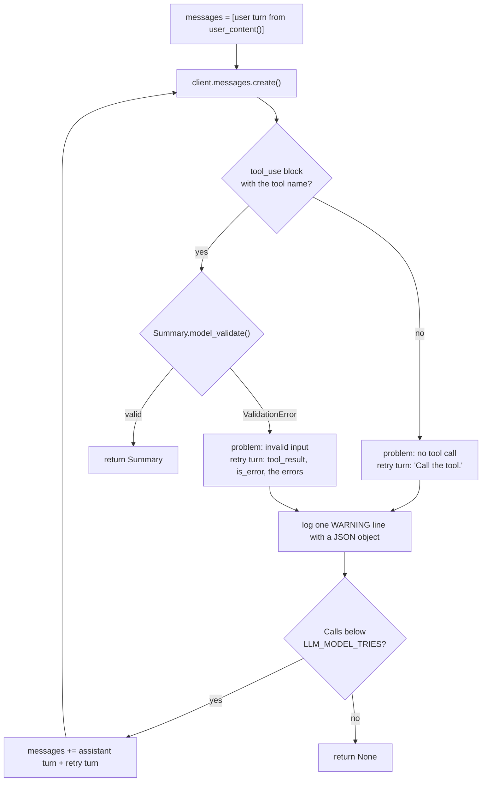
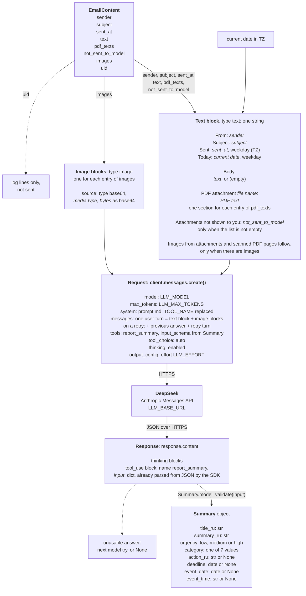

# summarize.py and prompt.md

Sources: [src/kindergarten_email_checker/summarize.py](../../src/kindergarten_email_checker/summarize.py), [src/kindergarten_email_checker/prompt.md](../../src/kindergarten_email_checker/prompt.md)

## Purpose

`summarize.py` sends one email to the model and returns a validated summary. It defines the output schema `Summary`, builds the request, calls DeepSeek in the Anthropic Messages API format, and validates the answer. It also holds the DeepSeek balance check for the start check.

`prompt.md` is the system prompt. `summarize.py` reads it once, at import.

## Who runs it

| Caller | Function | When |
|--------|----------|------|
| `main.check_services()` | `check_balance()` | Once at start |
| `main.process()` | `summarize()` | Once for each email from an allowed sender |
| `telegram.py` | `Summary` | Imported as a type. The post reads its fields |

## Layout

| Item | Kind |
|------|------|
| Module docstring | The request in short |
| `log` | Module logger |
| `SYSTEM_PROMPT` | Constant, read from `prompt.md` at import |
| `Urgency`, `Category` | Type aliases: the allowed values |
| `NO_VALUE` | Constant |
| `Summary` | pydantic model: the output schema |
| `tool_definition()` | Function |
| `BalanceError` | Exception class |
| `check_balance()` | Function: start check |
| `make_client()` | Function |
| `summarize()` | Function: the entry point of the module |
| `user_content()` | Function |

### `Summary`

The output schema. The model fills it in as the input of the tool call.

| Field | Type | Meaning |
|-------|------|---------|
| `title_ru` | `str` | Title, one line, up to 60 characters |
| `summary_ru` | `str` | Up to 3 short sentences, up to 350 characters |
| `urgency` | `Urgency`: `low`, `medium`, `high` | How soon the parent must act |
| `category` | `Category`: `info`, `event`, `action_required`, `payment`, `closure`, `health`, `other` | Topic, shown as a label |
| `action_ru` | `str` or `None` | What the parent must do |
| `deadline` | `date` or `None` | Date by which the parent must act |
| `event_date` | `date` or `None` | Date of the event |
| `event_time` | `str` or `None` | Time of the event, `HH:MM` |

Why it is a class: one pydantic model does three jobs.

1. `Summary.model_json_schema()` gives the `input_schema` of the tool. The Russian field descriptions are part of this schema, so the model reads them as instructions.
2. `Summary.model_validate()` checks the tool input: the enum values, the date format, the required fields.
3. `telegram.py` reads the typed fields. `deadline` and `event_date` are `date` objects, not text.

The length limits are only in the descriptions. The model does not get a validation error for a long title.

### `text_null_is_none(value)`

A validator on `action_ru`, `deadline`, `event_date` and `event_time`. It runs before the type check. The model sometimes writes the text `"null"` instead of JSON `null`. The validator changes the texts in `NO_VALUE` to `None`, so this answer is valid and needs no retry.

### `tool_definition(settings) -> dict`

Returns the definition of the one tool in the request: the name `LLM_TOOL_NAME`, a short description, and the schema of `Summary`. The model returns the summary as the input of a call to this tool. DeepSeek's Anthropic format has no JSON mode and no structured-output mode, so the tool call carries the schema.

### `BalanceError`

An exception class for a failed balance check. Why it is a class: `main.check_services()` writes the exception type name in its error line. `BalanceError: DeepSeek account cannot call the API` is clearer than a general `Exception`. The class has no body.

### `check_balance(settings) -> str`

Sends `GET /user/balance` to DeepSeek. The request is free.

1. Builds the URL from `LLM_BASE_URL`. `httpx2.URL.join("/user/balance")` replaces the path, so `https://api.deepseek.com/anthropic` gives `https://api.deepseek.com/user/balance`.
2. Sends the API key in the `Authorization: Bearer` header. The timeout is `LLM_BALANCE_TIMEOUT_SECONDS`.
3. When the status is not 200, raises `BalanceError` with the status and the error message from DeepSeek. A wrong key gives 401.
4. Joins the balances of all currencies as text, for example `4.20 USD`. `balance_infos` has one entry for each currency on the account: CNY, USD or both.
5. When `is_available` is `false`, raises `BalanceError` with the balances. DeepSeek sets this field: `false` means that the account cannot call the API now, for example with a zero balance.
6. Returns the balances. `main.check_services()` writes them to the log.

### `make_client(settings) -> anthropic.Anthropic`

Creates the `anthropic` SDK client with `LLM_BASE_URL`, `LLM_API_KEY` and `LLM_TIMEOUT_SECONDS`. The SDK repeats a request after a timeout, 429 or 5xx. Read "HTTP try" in [README.md](README.md#http-try). `summarize()` creates a new client for each email. Tests pass a fake client instead.

### `summarize(content, settings, client=None) -> Summary | None`

Asks the model for a `Summary`. It makes at most `LLM_MODEL_TRIES` model calls, default 2.



Request parameters:

| Parameter | Value | Why |
|-----------|-------|-----|
| `model` | `LLM_MODEL` | `deepseek-flash` accepts images |
| `max_tokens` | `LLM_MAX_TOKENS` | Thinking and the tool call share this limit |
| `system` | `SYSTEM_PROMPT` with `{TOOL_NAME}` replaced | The prompt and the tool definition use the same name |
| `messages` | The user turn. On each further call also the earlier answers and retry turns | The model sees its own mistakes |
| `tools` | `[tool_definition()]` | One tool |
| `tool_choice` | `{"type": "auto"}` | DeepSeek rejects a forced tool choice when thinking is on. The prompt asks for the call |
| `thinking` | `{"type": "enabled", "budget_tokens": 8000}` | Thinking stays on. DeepSeek ignores the budget |
| `output_config` | `{"effort": LLM_EFFORT}` | DeepSeek reads the thinking effort from here |

On a retry, the full previous answer goes back as the assistant turn, with the thinking blocks. The retry turn depends on the problem:

| Problem | Retry turn |
|---------|------------|
| No call of the tool | A user text: `Call the report_summary tool.` |
| Invalid tool input | A `tool_result` block for the same `tool_use_id`, with `is_error: true`, the validation errors and the request to call the tool again |

When DeepSeek gets tool arguments that are not valid JSON, it returns the tool call with an empty input `{}`. This input fails validation and gets the retry turn for invalid input.

Each problem gives one log line: `uid=<uid> attempt <n>: <JSON object>`. The object holds the problem, and for invalid input also the input and the errors. `ensure_ascii=False` keeps the Russian text readable.

After `LLM_MODEL_TRIES` problems, the function returns `None`. `main.process()` then posts the original text. API errors are not caught: they go to `main.process()`, which counts a failed attempt.

The result is a `Summary` object. The `anthropic` SDK parses the JSON answer, so `tool_use.input` is already a `dict`. `Summary.model_validate()` turns this `dict` into the `Summary` object with typed fields: `deadline` and `event_date` are `datetime.date` objects, not text. `telegram.py` reads the attributes of this object.

The diagram shows the whole call: how `EmailContent` becomes the request, and how the answer becomes the `Summary` object:



### `user_content(content, settings) -> list[dict]`

Builds the content of the user turn. The first block is text:

```text
From: <sender>
Subject: <subject>
Sent: <YYYY-MM-DD HH:MM, weekday> (<TZ>)
Today: <YYYY-MM-DD, weekday>

Body:
<body text, or (empty)>

PDF attachment <name>:
<PDF text>

Attachments not shown to you: <names>

Images from attachments and scanned PDF pages follow.
```

The PDF sections and the last two lines are present only when they have content. `Today` is in the `TZ` timezone. The model needs it to set `urgency`, because urgency counts from today. It needs `Sent` to resolve relative dates such as "el viernes".

After the text block, there is one `image` block for each item in `content.images`, as base64.

The diagram in the `summarize()` section shows these blocks in the request.

### `prompt.md`

The system prompt, in English. It tells the model:

- the reader: a Russian-speaking parent who rarely reads email;
- the input: metadata, body, PDF texts, images, in Spanish;
- to call the tool `{TOOL_NAME}` exactly once and not to answer in prose;
- to write every text field in Russian and to keep proper nouns as written;
- the rules for each field, the same as the field descriptions of `Summary`, with more detail;
- how to set `urgency`: by how soon the parent must act, not by the topic;
- to ignore signatures, legal footers and logos;
- what to do with an email without content, for example "log in to the platform".

The instruction to call the tool is the only thing that makes the model call it. The request cannot force the call: DeepSeek rejects a forced `tool_choice` when thinking is on, so the request uses `auto`. "Exactly once" matters because `summarize()` reads only the first call. "Not in prose" matters because the app ignores text blocks. An answer without the call is unusable and gets the retry turn "Call the report_summary tool."

`{TOOL_NAME}` is the only placeholder. The prompt names the timezone `America/Argentina/Buenos_Aires` in plain text. When `TZ` changes, the prompt still names the old timezone. The `Sent` line of the user turn names the timezone from `TZ`.

## Constants, limits and flags

| Name | Value | Meaning |
|------|-------|---------|
| `SYSTEM_PROMPT` | Content of `prompt.md` | Read at import. A missing file stops the app at start |
| `Urgency` | `low`, `medium`, `high` | Allowed urgency values |
| `Category` | 7 values | Allowed category values. `telegram.CATEGORY_LABEL` must have a label for each |
| `NO_VALUE` | `""`, `"null"`, `"none"` | Texts that count as no value, case-insensitive |
| `LLM_MODEL_TRIES` | Setting, default 2 | Model calls in one attempt. Read "Retries" in [README.md](README.md#retries) |
| `budget_tokens` | 8000, code only | Required in the Anthropic format. DeepSeek ignores it |
| `LLM_MODEL`, `LLM_EFFORT`, `LLM_MAX_TOKENS`, `LLM_TOOL_NAME` | Settings | Request parameters |
| `LLM_TIMEOUT_SECONDS`, `LLM_BALANCE_TIMEOUT_SECONDS` | Settings | Timeouts |

## Errors and exit codes

| Situation | Result |
|-----------|--------|
| `check_balance()`: wrong key, `is_available` is `false`, no connection | Exception to `main.check_services()`. Exit code 1 |
| `summarize()`: `LLM_MODEL_TRIES` unusable answers | Returns `None`. Not an error |
| `summarize()`: timeout, 429, 5xx after the SDK retries, 4xx | Exception to `main.process()`. One failed attempt |

## Tests

`tests/test_summarize.py` uses a fake client that returns prepared answers and records each request. It covers:

- a valid tool call returns a `Summary`;
- invalid input is retried with a `tool_result` error block;
- invalid input is logged as one line of JSON;
- two bad answers return `None`;
- the number of model calls comes from `LLM_MODEL_TRIES`;
- the text "null" means no value and needs no retry;
- the tool schema matches the `Summary` model;
- the balance check: an available account, `is_available` is `false`, a wrong key;
- the system prompt names the tool.
